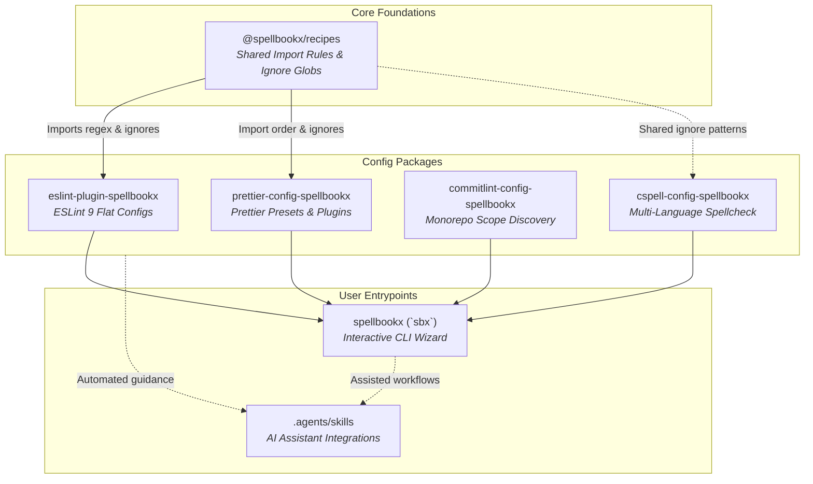

# Spellbookx Architecture

## 1. Executive Summary & Philosophy

**Spellbookx** is a modular, high-performance monorepo providing composable, production-ready developer toolchain configurations for modern JavaScript, TypeScript, React, Astro, Svelte, and Node.js environments.

The project is guided by four foundational architectural principles:

1. **Native Modern Standards First**: Exclusively target modern web and tooling standards—ESLint 9+ Flat Configs, pure ECMAScript Modules (`"type": "module"`), TypeScript strict mode, and native Node.js / pnpm workflows without legacy wrappers or polyfills.
2. **Single Source of Truth (SSOT)**: Shareable primitives, such as import order groupings, ignore globs, and framework definitions, are centralized in `@spellbookx/recipes` and reused uniformly across ESLint, Prettier, and CSpell.
3. **Strict Dogfooding**: The monorepo uses its own configuration packages (`eslint-plugin-spellbookx`, `prettier-config-spellbookx`, `commitlint-config-spellbookx`, `cspell-config-spellbookx`) across all its source code, root configs, and sub-packages.
4. **Infinite Composability & Zero Friction**: Every preset can be used out-of-the-box with a one-line import, or composed and customized via helper functions like `defineSbxConfig`.

---

## 2. Monorepo Structure & Package Topology

The repository is organized as a pnpm workspace orchestrated by **Turborepo** for build caching and topological pipeline execution.

```text
spellbookx/
├── @spellbookx/
│   └── recipes/                     # Core shared recipes (import regexes & ignore patterns)
├── packages/
│   ├── eslint-plugin-spellbookx/     # ESLint 9+ Flat Config plugin with 16 modular presets
│   ├── prettier-config-spellbookx/   # Prettier presets, plugins & defineSbxConfig composer
│   ├── commitlint-config-spellbookx/ # Monorepo scope auto-discovery & cz-git interactive prompt
│   ├── cspell-config-spellbookx/     # Multi-language & technical spellcheck configuration
│   └── spellbookx/                   # CLI wizard (`sbx`) for interactive toolchain scaffolding
├── .agents/
│   └── skills/                       # Built-in AI Agent skills for assisted toolchain adoption
├── .changeset/                       # Changesets release orchestration & lockstep versioning
├── docs/                             # Architecture documentation & Architecture Decision Records (ADRs)
│   ├── architectures.md              # System architecture documentation
│   └── decisions/                    # Architecture Decision Records (ADRs)
└── turbo.json                        # Monorepo pipeline definition
```

### Dependency & Relationship Graph



---

## 3. Package Architecture & Deep Dives

### 3.1 `@spellbookx/recipes`

- **Role**: Foundational, zero-dependency library providing curated constants and regex patterns.
- **Components**:
  - `imports`: Categorized RegExp rules for module import ordering (e.g., node built-ins, framework runtimes, component libraries, state management, utilities, internal aliases, styles).
  - `ignores`: Exhaustive ignore globs grouped by domain (Node runtime artifacts, package managers, build outputs, frameworks like Astro/Next/Svelte, test runners, operating system artifacts).
- **Export Strategy**: Provides both granular exports (`@spellbookx/recipes/imports`, `@spellbookx/recipes/ignores`) and a root aggregator.

### 3.2 `eslint-plugin-spellbookx`

- **Role**: ESLint 9+ native Flat Config plugin exporting 16 modular presets.
- **Key Modules**:
  - `recommended`: Standard TypeScript & JavaScript best practices.
  - `recommended-spellcheck`: Recommended rules + integrated CSpell linting.
  - Framework configs: `react`, `astro`, `svelte`, `node`.
  - Format & syntax configs: `json`, `markdown`, `strict`, `all`, `vuoto` (clean baseline).
- **Import Sorting**: Integrates `eslint-plugin-simple-import-sort` driven by patterns from `@spellbookx/recipes/imports`.
- **Ignore Strategy**: Exports `configs.ignores` utilizing `@spellbookx/recipes/ignores`.

### 3.3 `prettier-config-spellbookx`

- **Role**: Prettier configuration bundle supporting multi-framework formatting.
- **Key Modules**:
  - Modular presets for Tailwind CSS class sorting, Astro, Svelte, Prisma, SQL, Nginx, XML, and multiline arrays.
  - `defineSbxConfig`: A configuration composer function that deduplicates plugins, validates mutual exclusion, and merges custom override options.
  - Import sorting via `@ianvs/prettier-plugin-sort-imports` or `prettier-plugin-organize-imports`, aligning with `@spellbookx/recipes`.

### 3.4 `commitlint-config-spellbookx`

- **Role**: Monorepo-aware Conventional Commits configuration.
- **Key Features**:
  - **Dynamic Scope Resolution**: Inspects workspace manifests (`pnpm-workspace.yaml`, `package.json` workspaces, and `lerna.json`) at runtime to dynamically allow workspace package names as valid commit scopes without hardcoding.
  - **Interactive Commit Prompt**: Built-in integration with `cz-git` providing a styled CLI prompt for constructing standardized commit messages.

### 3.5 `cspell-config-spellbookx`

- **Role**: Shareable spell-checking configuration powered by CSpell.
- **Key Features**:
  - Bundled dictionaries for programming terms, tooling jargon, and multi-language support (English, Italian, Spanish, French, German).
  - Pre-configured ignore paths matching `@spellbookx/recipes/ignores`.

### 3.6 `spellbookx` (CLI: `sbx`)

- **Role**: Interactive terminal wizard for bootstrapping and managing the Spellbookx toolchain in user projects.
- **Stack**: Built with `commander`, `@inquirer/prompts`, `ora`, `chalk`, and `execa`.
- **Capabilities**: Detects project framework (React, Astro, Svelte, Node), package manager, and existing configs; interactively scaffolds `eslint.config.mjs`, `prettier.config.mjs`, `commitlint.config.mjs`, `cspell.json`, and installs required dependencies.

### 3.7 `.agents/skills`

- **Role**: AI coding assistant context and automation manifests.
- **Purpose**: Enables agents (Antigravity, Cursor, Copilot, Cline) to read structured skill manifests (`SKILL.md`) to safely configure, troubleshoot, and migrate projects to Spellbookx.

---

## 4. Build, Test, & Release Pipeline

### 4.1 Build Engine: Rolldown & TypeScript

- Packages compile using **Rolldown** (`rolldown -c`), delivering ultra-fast bundling of ECMAScript modules.
- Type definitions (`.d.ts`) are generated concurrently with `tsc`.
- All sub-packages output cleanly to their local `dist/` directories with root-level and sub-path exports defined in `package.json`.

### 4.2 Monorepo Task Orchestration: Turborepo

Turborepo coordinates dependencies and parallel execution across the workspace:

```json
{
  "$schema": "https://turbo.build/schema.json",
  "tasks": {
    "build": {
      "dependsOn": ["^build"],
      "outputs": ["dist/**"]
    },
    "lint": {},
    "test": {},
    "release": {
      "dependsOn": ["build"],
      "cache": false
    }
  }
}
```

- `dependsOn: ["^build"]` ensures that foundational dependencies (such as `@spellbookx/recipes`) are built before consuming packages (`eslint-plugin-spellbookx`, `prettier-config-spellbookx`).
- `turbo run release` executes each package's `release` script (`pnpm publish --access public --no-git-checks`) with fresh compilation and zero caching.

### 4.3 Versioning & Publishing: Changesets

- Versioning is synchronized across packages using `@changesets/cli` with a `fixed` configuration group.
- Conventional Commits are mapped into changeset entries via `changeset-conventional-commits`.
- Publishing workflow:
  1. `pnpm run changeset` / `pnpm run changeset:conventional` to create release intents.
  2. `pnpm run version` (`changeset version`) to update package versions and changelogs.
  3. `pnpm run release` (`turbo run release`) to build and push artifacts to the npm registry.

---

## 5. Quality Assurance & Git Automation

- **Pre-commit Automation**: Managed by **Lefthook** (`lefthook.yml`). Executes staged-file formatting, ESLint validation, and CSpell checks in parallel before commits are allowed.
- **Commit-msg Validation**: Lefthook triggers `@commitlint/cli` using `commitlint-config-spellbookx` to enforce Conventional Commits rules on every commit message.
- **Unit Testing**: Vitest runs unit and integration tests across all packages, verifying preset outputs, rule validity, and CLI flows.
